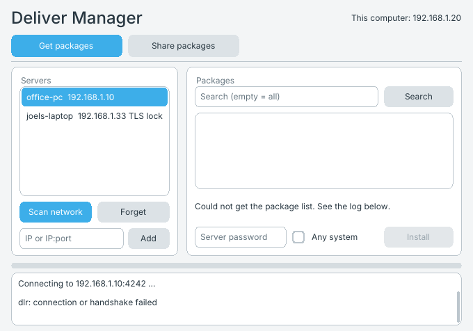

# Deliver Manager

A desktop app for [Deliver](https://github.com/fsminecrafter/Deliver), the
LAN package manager: get packages from other computers, and share your own.
It is the window version of the `dlr` command and uses the same code
(`programs/dlr`), so both always speak the same protocol and install
packages the same way.

Minimal-OS ships it as `0:/programs/DeliverManager.run`; it shows up on the
MOSdesk desktop as **DeliverManager**. It needs MOSdesk (it opens a window);
in the terminal use `dlr` instead.

## Get packages

1. **Scan network** listens for Deliver servers for 5 seconds. Servers
   found are added to the list (servers you added by address stay). Under
   QEMU's default `-netdev user` broadcasts do not arrive; add the server by
   address instead.
2. Or type an address (`192.168.1.10`, `192.168.1.10:4242`, or
   `tls://192.168.1.10` for a TLS server) and press **Add**.
3. Click a server to list its packages. **Search** filters them (an empty
   search lists everything). Servers marked `locked` need a password: type it
   in the password box first.
4. Pick a package and press **Install** (or double-click it). The download is
   checked against its SHA-256 and installed as the package's
   `[Install.minimalos]` section says. **Any system** installs a package that
   says it is for another OS or architecture (`dlr install --force`).

**Forget** removes a server from the list. The list is the same file `dlr`
uses, `0:/etc/dlr/servers.txt`.

## Share packages

1. Put the package's files in a folder with a `.pkg` manifest. **New .pkg in
   folder** writes a starter manifest named after the folder; edit its
   description (and `copy=` / `target=` if needed).
2. Type the folder and press **Present folder**. It is copied into the store
   (`0:/var/dlrd/packages`) and packed once, like `dlr present`.
3. Set a server name, port (4242) and an optional password, then **Start
   server**. Other computers find it with a scan (it says hello every 5 s) or
   add it by address. Turn on **TLS** to serve the TLS transport on port 4342
   (other Minimal-OS computers only).

**Rebuild** re-packs a package after you edit its files in the store, and
**Stop offering** removes it. These are `dlr rebuild` and `dlr unpresent`.

The server runs inside the app while the window is open and stops when it
closes. Each client is served in the app's own process (as `dlr serve` does
on Minimal-OS), so the window waits while a client downloads.

## Building

    ./build.sh programs/delivermanager

`deliver/*.c` each include one source file of `programs/dlr`, so the app is
built from the same code without copying it. `Resources/icon.bmp` is the
desktop icon; `make_icon.py` draws it.

The Minimal-OS image build (`make`) builds it into
`src/resources/install2/DeliverManager.run`.
